# VOLANT

Configurateur 3D de volants Mercedes-AMG, dans le navigateur.

On choisit un volant parmi 28 générations de Mercedes-AMG, de la C217 de 2013 à la G-Classe W465 de 2024, puis on
le modifie pièce par pièce : jante, cuir, Alcantara, carbone, coutures, branches, palettes. Le volant est en 3D temps
réel : on le fait tourner, on clique sur une pièce pour la changer, et on peut le voir monté dans l'habitacle d'une
Classe S.

Le code source est privé. Cette page présente le projet.

**[Essayer la démo](https://ali213000.github.io/volant-presentation/)** : elle contient les 15 volants reconstruits
en code. Les volants extraits de jeux et l'habitacle ne sont montrés ici qu'en images.

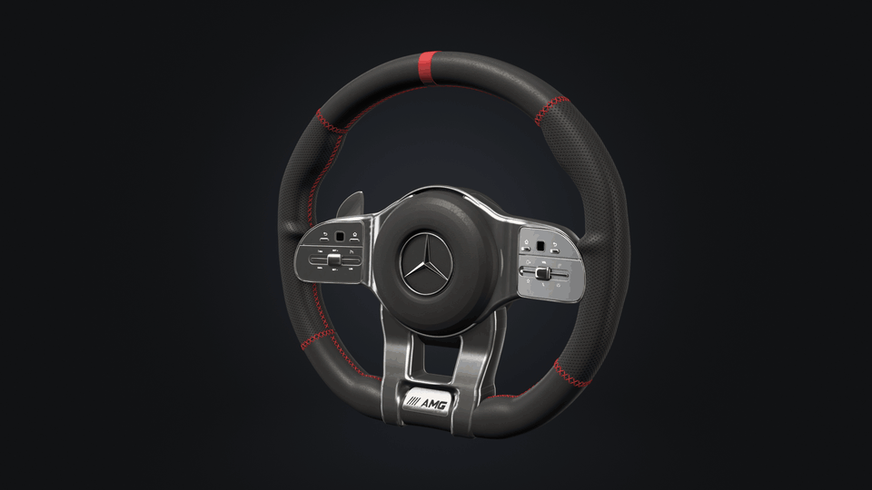

## Ce que l'on peut faire

### Choisir un volant

La bibliothèque classe les volants par châssis (W205, W213, W222, X253, W177, V167, W223, AMG GT, G-Classe…),
du plus récent au plus ancien, avec d'autres tris possibles. Chaque fiche donne les années, les modèles et ce qui
distingue la génération : touches physiques, pavés tactiles ou commandes capacitives, branche basse, AMG Drive Unit.

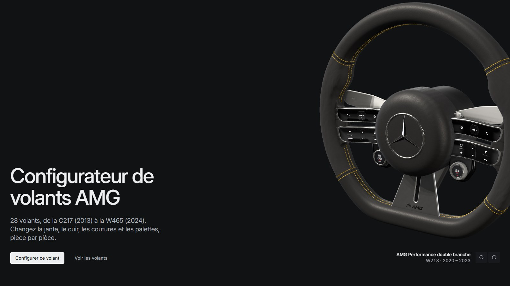

### Le modifier pièce par pièce

Les pièces du volant sont dans une bande en bas, chacune avec une petite vue 3D. Un clic sur une pièce, dans la
bande ou directement sur le volant, la fait s'éclairer un instant puis l'entoure. Les réglages sont à droite :
matière, couleur, finition. Chaque modification est visible tout de suite, et peut être annulée.

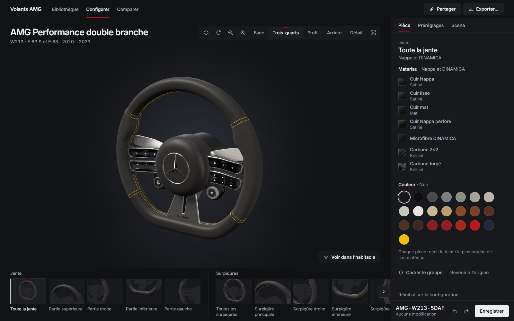

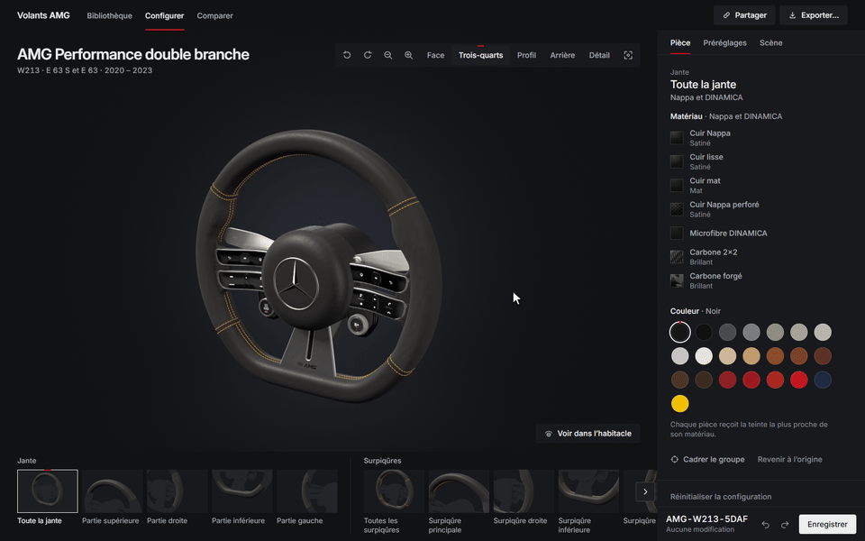

### Les coutures

Les coutures sont de vrais fils en 3D qui suivent la forme de la jante : simple, double, croisée ou zigzag, avec la
couleur, l'épaisseur du fil, la longueur du point et leur position sur la jante.

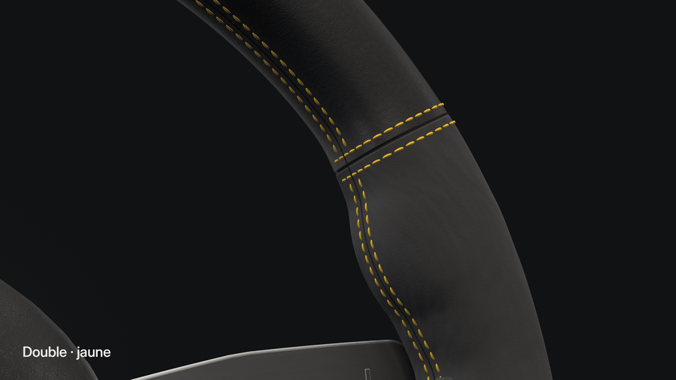

### Les préréglages

AMG Classique, Black Edition, Carbon Edition, Rouge AMG, Alcantara Edition, Full Carbon : chaque préréglage montre
le volant en cours avec ce style appliqué, avant de le choisir.

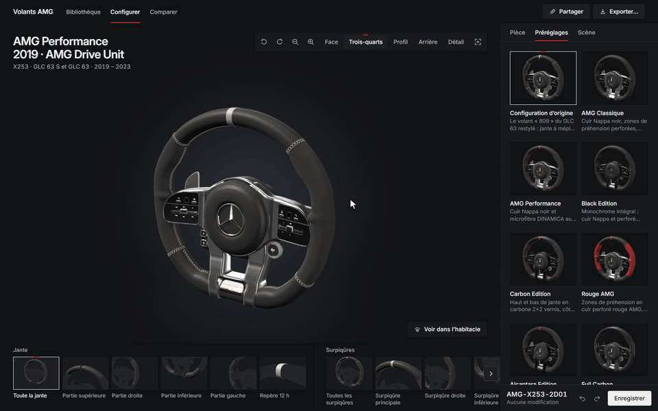

### Dans l'habitacle

Le volant configuré se monte à la place exacte du volant d'origine, dans l'habitacle d'une Classe S W223 : même
centre, même inclinaison de colonne, même échelle. Les vues conducteur et passager restent à l'intérieur de la voiture.

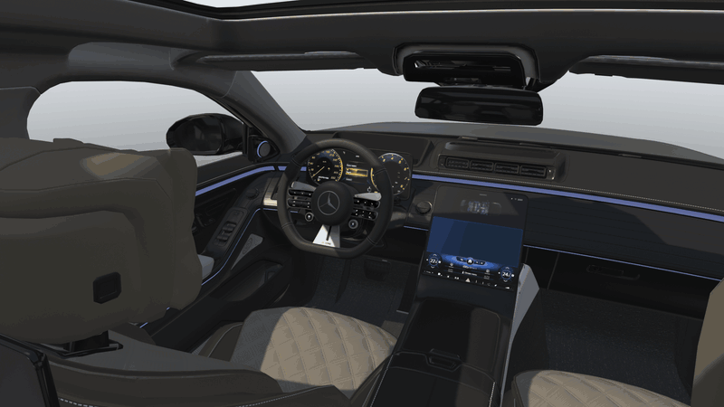

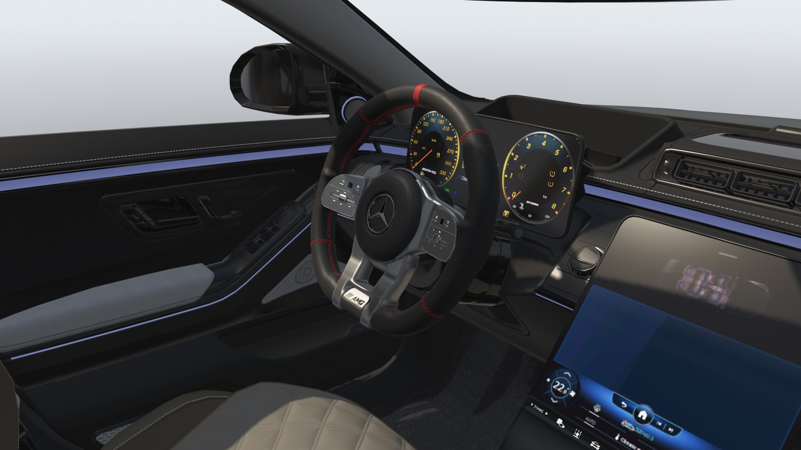

### Comparer deux volants

Deux scènes côte à côte, avec des caméras liées, et un tableau des différences : années, commandes, jante, matières,
coutures.

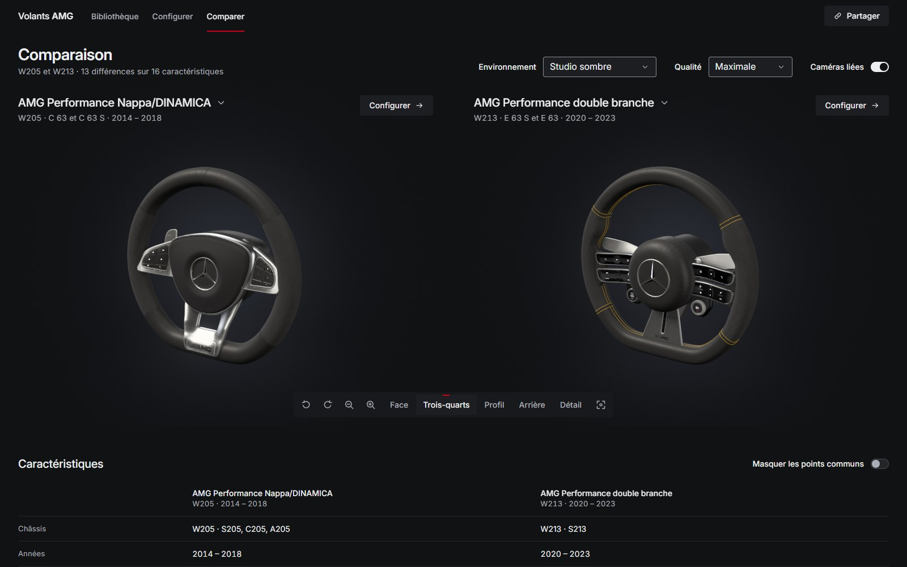

### Sur téléphone

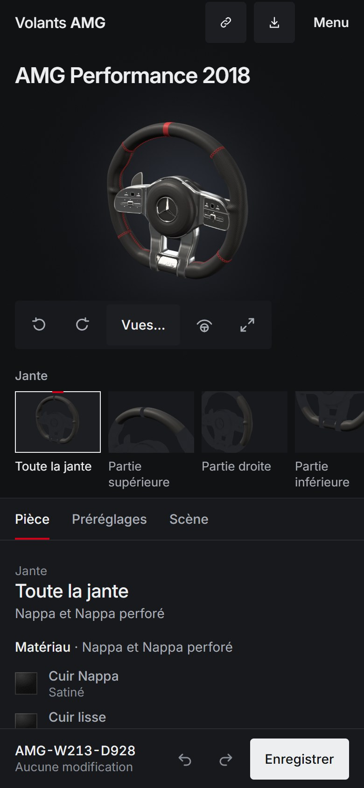

Chaque configuration a un code (par exemple `AMG-W205-8F92`) et un lien de partage. On peut l'exporter en image
haute définition, en fiche imprimable, en JSON ou en modèle 3D (GLB).

## Les volants

28 volants sur 15 châssis. Chaque génération a été datée à partir des catalogues de pièces, des notices et des photos
presse, pour ne pas mélanger un volant d'avant restylage avec celui d'après.

- **15 volants reconstruits en code**, en trois familles : la génération 1 à touches physiques (2013-2018), la
  génération 2018 que les vendeurs de pièces appellent « 809 », et la génération 2020 à double branche et commandes
  capacitives. Les proportions ont été calées sur des volants réels de la même famille.
- **13 volants extraits** de modèles Assetto Corsa installés sur mon PC, par un outil écrit pour le projet, puis
  découpés en pièces configurables.

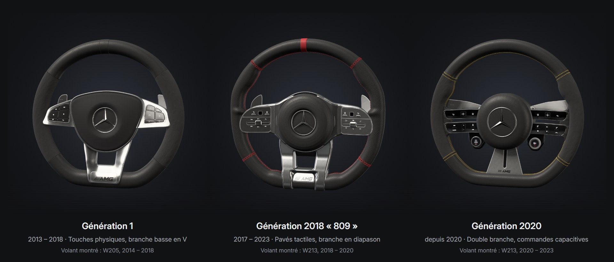

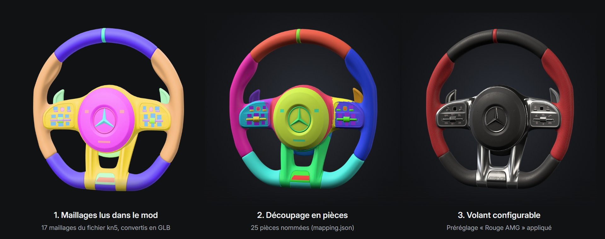

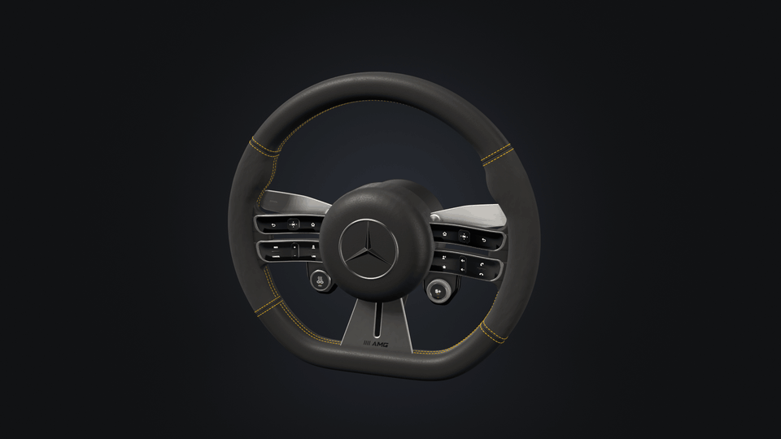

## Côté technique

- **Application** : TypeScript et Three.js, sans framework, Vite. Routes par l'URL, interface en français, pensée
  pour ordinateur et téléphone.
- **Volants en code** : chaque famille est un programme qui construit le volant à partir de paramètres en
  millimètres. La jante est une section qui varie le long du tour (bas plat, épaisseurs des zones de prise),
  découpée en zones séparées par une fine rainure. Les variantes ne sont que des données : ajouter un volant revient
  à ajouter un fichier.
- **Coutures** : des milliers de points en géométrie instanciée, posés sur la surface de la jante et orientés par
  elle, dans quatre styles. Elles se reconstruisent en quelques millisecondes quand on change un réglage.
- **Matières** : textures PBR générées par le code (grain du cuir Nappa, perforations, microfibre, tissage du
  carbone, carbone forgé, aluminium brossé), à l'échelle réelle. La couleur affichée correspond au nuancier.
- **Rendu** : studios photo construits en 3D (boîtes à lumière, bandes lumineuses, contre-jours) qui servent
  d'environnement de reflets, occlusion ambiante, ombres douces. Quand la caméra s'arrête, l'image s'affine sur
  quelques dizaines d'images (anti-crénelage et ombres sans bruit), puis plus rien n'est calculé.
- **Sélection** : clic sur la pièce dans la scène 3D, y compris sur un point de couture. Un éclat blanc puis un
  contour qui ne suit que la partie visible de la pièce.
- **Fluidité** : rendu à la demande, chemin allégé pendant la rotation, compilation des shaders et envoi des
  textures avant la première interaction. Mesuré par un outil maison : moins de 7 ms de calcul par image en studio sur une carte graphique récente, même
  en 2560 × 1440. Trois niveaux de qualité pour les appareils plus modestes.
- **Extraction** : lecteur maison du format de modèles d'Assetto Corsa (KN5), décodage des textures DDS, export
  GLB. Le volant est retrouvé dans la voiture, recalé (centre, plan, midi), puis découpé en pièces nommées par un
  fichier de correspondance. Les fichiers chiffrés par leurs auteurs sont refusés. L'habitacle est extrait de la
  même façon, sans son volant, avec la position exacte de la colonne de direction.
- **Configurations** : historique annuler / rétablir, codes de partage stables, liens qui ne contiennent que les
  différences avec l'origine, sauvegardes locales. Exports PNG jusqu'à 4096 px, fiche imprimable, JSON, GLB.
- **Vérification** : captures automatiques de chaque volant et de chaque page dans un vrai navigateur, pour
  contrôler la géométrie, les pièces et la mise en page. Budget de 400 000 triangles et 60 appels de rendu par volant.

## État du projet

Projet personnel, terminé et utilisé en local. 28 volants, 15 châssis, 3 familles reconstruites en code. La démo
publique contient les 15 volants reconstruits en code. Interface en français.

## Crédits

Les volants extraits et l'habitacle visibles sur cette page proviennent de modèles Assetto Corsa créés par la
communauté. Ils appartiennent à leurs auteurs : ils sont utilisés en privé et ne sont pas distribués, ni dans ce
dépôt ni dans la démo.

- Habitacle et volant de la Classe S W223 : « Mercedes S63 S E-Performance », EGCU
- Mercedes-AMG C 63 S W205 : OnVisu
- Mercedes-AMG E 63 S W213 : mod « as_mercedes_amg_e63s »
- Mercedes-AMG S 63 W222 : lew1x
- Mercedes-AMG GLC 63 S : ACTK, MOLOD, PFA
- Mercedes-AMG A 45 S : 101creative
- Mercedes-AMG GT 63 S 4 portes : B. Gili
- Mercedes-AMG G 63 W463 : B. Gili, Corych Workshop
- Mercedes-AMG GT S Roadster : auteur non indiqué

Mercedes-Benz, Mercedes-AMG et l'étoile sont des marques de Mercedes-Benz Group AG. Projet personnel, sans lien avec
la marque.
